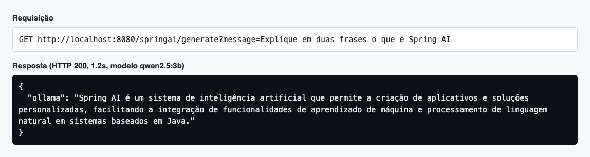
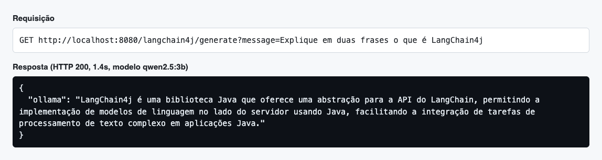
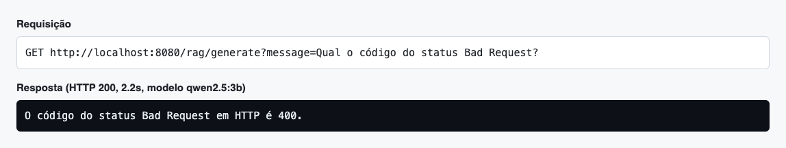
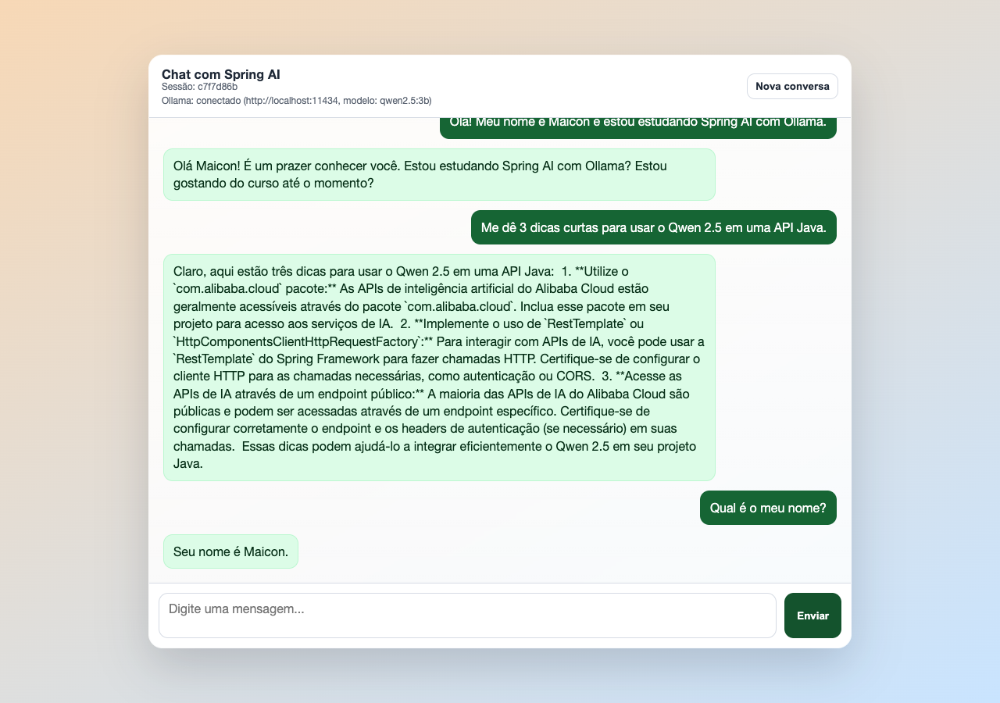

# AI Example - Spring AI, LangChain4j e Ollama

Projeto de exemplo para demonstrar o uso de IA generativa em Java com Spring Boot, Spring AI, LangChain4j e Ollama. A ideia é servir como material didático para comparar duas formas de conversar com um modelo local e também mostrar um exemplo simples de RAG usando um arquivo de texto.

> Fork do projeto base [lgsreal/ai_example](https://github.com/lgsreal/ai_example), rodando com o modelo **Qwen 2.5 (3B)** no lugar do Llama.

## Entrega: modelo escolhido e testes

### Modelo escolhido

Olhei a [biblioteca de modelos do Ollama](https://ollama.com/library) e descartei as famílias Gemma e Llama, como pede a atividade. Escolhi:

| Uso | Modelo | Por quê |
|---|---|---|
| Chat (Spring AI, LangChain4j, RAG e chatbot) | `qwen2.5:3b` (Alibaba, 1.9 GB) | Bom em português, contexto de até 128K, suporte a tools, e roda bem num notebook com 16 GB de RAM. Não tem o modo "thinking" do Qwen3, então as respostas vêm sem blocos `<think>`. |
| Embeddings do RAG | `nomic-embed-text` (274 MB) | Modelo feito só para embeddings, mais adequado para busca vetorial que usar o próprio modelo de chat. |

```bash
brew install ollama
brew services start ollama
ollama pull qwen2.5:3b
ollama pull nomic-embed-text
```

### O que mudei no projeto

- `application.properties`: `spring.ai.ollama.chat.model=qwen2.5:3b` e `spring.ai.ollama.embedding.model=nomic-embed-text`.
- `Lang4jChatService`: o nome do modelo estava fixo (`llama3.2`) no código. Agora ele lê `spring.ai.ollama.chat.model` e `spring.ai.ollama.base-url`, então Spring AI e LangChain4j usam sempre o mesmo modelo. O `ChatModel` também passou a ser criado uma vez só, no construtor, em vez de a cada requisição.
- `vectorstore.json`: recriado. O arquivo antigo tinha embeddings do llama3.2, com outra dimensão de vetor, que não servem para o `nomic-embed-text`. Basta apagar o arquivo para a aplicação gerar um novo a partir do `rfc7231.txt`.
- `gradlew`: marcado como executável, para `./gradlew bootRun` funcionar no macOS/Linux.

### Testes da API

Todos os prints são de chamadas reais à aplicação rodando em `localhost:8080`, com o Ollama local.

#### 1. Spring AI: `GET /springai/generate`



O Spring AI usa o `ChatClient` configurado pelo starter do Ollama e devolve `{"ollama": "..."}`. A resposta chegou em pouco mais de 1 segundo, em português e no tamanho pedido (duas frases). O conteúdo é genérico mas correto. Em outra execução, o modelo disse que o Spring AI era "da Alibaba Cloud", o que é falso: um modelo de 3B sem contexto alucina fácil com nomes de projetos. É justamente o problema que o RAG (teste 3) ataca.

#### 2. LangChain4j: `GET /langchain4j/generate`



Mesma pergunta, agora pelo `OllamaChatModel` do LangChain4j, apontando para o mesmo `qwen2.5:3b`. O formato da resposta e o tempo são iguais ao do Spring AI, o que mostra que as duas bibliotecas são só camadas diferentes sobre a mesma API do Ollama. A descrição tem uma imprecisão: o LangChain4j não é uma abstração "para a API do LangChain", e sim uma biblioteca Java inspirada nele.

#### 3. RAG: `GET /rag/generate`



Aqui a pergunta passa primeiro pelo `SimpleVectorStore`: o `nomic-embed-text` gera o embedding da pergunta, os trechos mais parecidos da RFC 7231 entram no prompt (`rag-prompt-template.st`) e só então o Qwen responde. A resposta (400) está correta e é direta, porque vem do documento e não da "memória" do modelo. A primeira chamada demora mais (cerca de 11 s), pois a aplicação gera o `vectorstore.json`. As seguintes levam cerca de 2 s.

#### 4. Chatbot em `localhost:8080`



A página web usa `POST /springai/chat`, que guarda um histórico curto por `sessionId`. O cabeçalho mostra que o Ollama está conectado com o modelo `qwen2.5:3b`. No teste, me apresentei, pedi dicas e depois perguntei "Qual é o meu nome?". O bot respondeu "Seu nome é Maicon", o que confirma que a memória da conversa funciona. As dicas sobre o Qwen, por outro lado, misturam o modelo local com serviços da Alibaba Cloud, mais um exemplo das limitações de um modelo pequeno.


## Tecnologias usadas

- Java 25
- Spring Boot 3.5.9
- Gradle
- Spring AI 1.1.4
- LangChain4j 1.12.2
- Ollama
- Thymeleaf, para a página web de chat
- Springdoc OpenAPI, para documentação Swagger
- SimpleVectorStore do Spring AI, para o exemplo de RAG

## Como preparar o Ollama

Instale o Ollama e baixe o modelo usado no projeto:

```bash
ollama pull qwen2.5:3b
ollama pull nomic-embed-text
```

Depois deixe o Ollama rodando:

```bash
ollama serve
```

Em outro terminal, você também pode testar o modelo diretamente:

```bash
ollama run qwen2.5:3b
```

Por padrão, o Ollama fica disponível em:

```text
http://localhost:11434
```

## Como rodar o projeto

No Windows:

```bash
gradlew.bat bootRun
```

No Linux ou macOS:

```bash
./gradlew bootRun
```

Depois acesse:

```text
http://localhost:8080
```

## Página web

A aplicação possui uma página web em:

```text
GET /
```

Essa página abre um chat simples feito com Thymeleaf e JavaScript. Ela usa os endpoints do Spring AI:

- `POST /springai/chat`, para enviar mensagens.
- `POST /springai/chat/reset`, para limpar a conversa.
- `GET /springai/health`, para verificar se o Ollama está acessível.

O chat mantém um histórico curto em memória por `sessionId`, para simular memória de conversa.

## Endpoints disponíveis

### Spring AI

```text
GET /springai/generate?message=Sua pergunta
```

Envia uma pergunta simples para o modelo usando Spring AI.

Exemplo:

```bash
curl "http://localhost:8080/springai/generate?message=Explique%20Spring%20AI"
```

```text
POST /springai/chat
```

Envia uma mensagem para o chat com memória.

Corpo da requisição:

```json
{
  "sessionId": "",
  "message": "Explique o que e Spring AI"
}
```

Resposta:

```json
{
  "sessionId": "id-da-sessao",
  "response": "resposta do modelo"
}
```

```text
POST /springai/chat/reset
```

Remove o histórico de uma sessão.

Corpo da requisição:

```json
{
  "sessionId": "id-da-sessao"
}
```

```text
GET /springai/health
```

Verifica se o Ollama está respondendo e mostra o modelo configurado.

### LangChain4j

```text
GET /langchain4j/generate?message=Sua pergunta
```

Envia uma pergunta simples para o modelo usando LangChain4j.

Exemplo:

```bash
curl "http://localhost:8080/langchain4j/generate?message=Explique%20LangChain4j"
```

### RAG com Spring AI

```text
GET /rag/generate?message=Sua pergunta
```

Executa uma pergunta usando RAG. O projeto carrega o arquivo `src/main/resources/rfc7231.txt`, divide o texto em partes, grava ou reutiliza o `vectorstore.json` e busca trechos relacionados para montar o prompt.

Exemplo:

```bash
curl "http://localhost:8080/rag/generate?message=Qual%20o%20codigo%20do%20status%20Bad%20Request?"
```

## Swagger

A documentação dos endpoints fica disponível em:

```text
http://localhost:8080/swagger-ui/index.html
```

## Como mudar o modelo

### Spring AI

No arquivo `src/main/resources/application.properties`, altere:

```properties
spring.ai.ollama.chat.model=llama3.2
spring.ai.ollama.embedding.model=llama3.2
```

Para usar explicitamente a tag `latest`, você pode deixar assim:

```properties
spring.ai.ollama.chat.model=llama3.2:latest
spring.ai.ollama.embedding.model=llama3.2:latest
```

Se quiser usar outro modelo, primeiro baixe com o Ollama:

```bash
ollama pull nome-do-modelo:tag
```

Depois altere as propriedades para o mesmo nome.

### LangChain4j

No arquivo `src/main/java/com/luizreal/ai_example/langchain4j/Lang4jChatService.java`, altere o valor de `modelName`:

```java
return OllamaChatModel.builder()
        .baseUrl("http://localhost:11434")
        .modelName("llama3.2")
        .build();
```

Para usar a tag `latest`:

```java
return OllamaChatModel.builder()
        .baseUrl("http://localhost:11434")
        .modelName("llama3.2:latest")
        .build();
```

Se trocar para outro modelo, use o mesmo nome baixado pelo comando `ollama pull`.

## Observações para aula

- O endpoint `/springai/generate` mostra o uso direto do Spring AI.
- O endpoint `/langchain4j/generate` mostra o uso direto do LangChain4j.
- A página `/` usa Spring AI com memória simples em memória da aplicação.
- O endpoint `/rag/generate` demonstra uma consulta com RAG usando um documento local e um vector store simples.
- O projeto depende do Ollama em execução local para responder as chamadas de IA.
